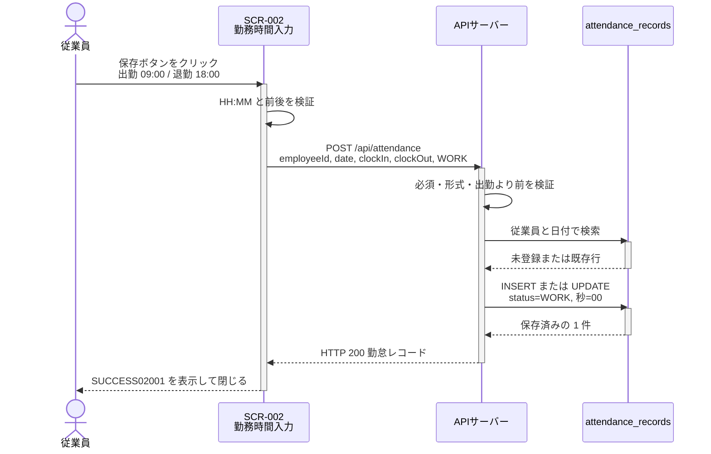
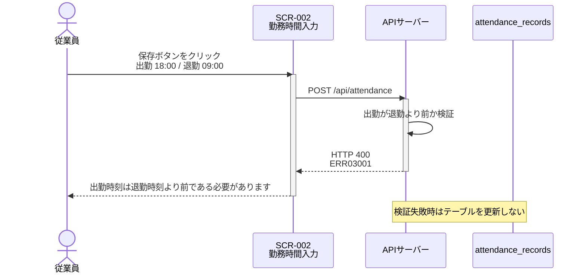
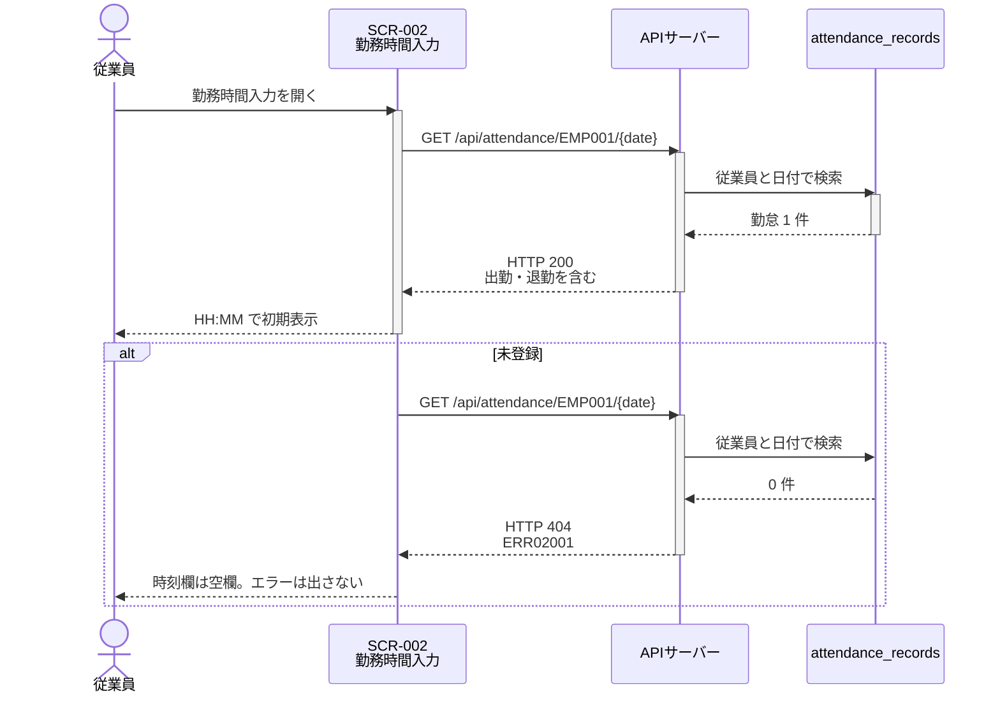

# シーケンス図

システムのコンポーネント間のやり取りを時系列で定義します。

## 命名規則

### シーケンス図ID

- **形式**: `SEQ-{連番3桁}` (例: `SEQ-001`)
- **命名規則**: フローの目的が明確になるように命名

## シーケンス図一覧

| シーケンス図ID | タイトル               | 概要                                           | 関連要件  | 関連画面 |
| -------------- | ---------------------- | ---------------------------------------------- | --------- | -------- |
| SEQ-UC003-001  | 勤務時間の保存         | 出勤・退勤を検証し、1 件の勤怠として保存する   | REQ-UC003 | SCR-002  |
| SEQ-UC003-002  | 勤務時間の検証失敗     | 不正な時刻を保存せず、ダイアログにエラーを出す | REQ-UC003 | SCR-002  |
| SEQ-UC003-003  | 保存済み勤怠の再取得   | 特定日の勤怠を取得し、更新時の初期表示に使う   | REQ-UC003 | SCR-002  |

---

## シーケンス図詳細

### SEQ-UC003-001: 勤務時間の保存

#### 目的

* 従業員が選択した日付の出勤時刻と退勤時刻を保存する
* 同じ従業員と日付の勤怠を 1 件に保つ

#### 範囲

* **トリガー**: 従業員が SCR-002 で保存ボタンをクリックする
* **含むコンポーネント**: 勤務時間入力ダイアログ（SCR-002）、`POST /api/attendance`、`attendance_records`
* **除外**: 認証、休暇登録（REQ-UC004）、カレンダーの勤怠バッジ

#### 前提条件

* メイン画面（SCR-001）が表示され、日付が選択されている
* 従業員 ID は `EMP001` とする
* 対象日は過去でも未来でもよい

#### 事後条件

* 検証成功時、当該従業員と日付の勤怠が 1 件になり、`status` は `WORK`、秒は `00` である
* 新規なら備考は NULL、更新なら既存の備考は変わらない
* 成功メッセージ SUCCESS02001 を表示し、ダイアログを閉じる

#### 基本フロー

1. 従業員が日付を選択し、勤務時間入力ダイアログを開く
2. ダイアログが特定日の勤怠を取得する（SEQ-UC003-003）
3. 従業員が出勤時刻と退勤時刻を `HH:MM` で入力する
4. 従業員が保存ボタンをクリックする
5. システムが出勤・退勤の必須、形式、前後を検証する
6. 検証に成功した場合、従業員と日付で既存行を探し、無ければ作成、あれば時刻とステータスを更新する
7. システムが保存成功を返し、画面が SUCCESS02001 を表示してダイアログを閉じる

#### 代替フロー

* **A1: 検証失敗** — SEQ-UC003-002 に従い、保存しない
* **A2: 通信失敗** — ERR99002 を表示し、ダイアログは閉じない
* **A3: キャンセル** — API を呼ばず、入力を破棄してダイアログを閉じる

#### シーケンス図

---

### SEQ-UC003-002: 勤務時間の検証失敗

#### 目的

* 不正な勤務時間を保存しない
* 利用者に日本語で修正箇所を伝える

#### 範囲

* **トリガー**: 保存ボタンをクリックしたとき、必須・形式・前後のいずれかに違反している
* **含むコンポーネント**: SCR-002、必要なら `POST /api/attendance`
* **除外**: データベースへの書き込み

#### 前提条件

* SCR-002 が開いている

#### 事後条件

* 勤怠レコードは追加も更新もされない
* ダイアログは開いたまま、該当メッセージを表示する

#### 基本フロー

1. 従業員が保存ボタンをクリックする
2. 画面または API が入力を検証する
3. 違反がある場合、保存せず ERR03001、ERR03002、または ERR03003 を表示する
4. 従業員が時刻を修正できる状態のままダイアログを維持する

#### 代替フロー

* **A1: 画面で不足を検出** — API を呼ばずに ERR03003 または ERR03002 を表示する
* **A2: API が 400 を返す** — 応答のメッセージをダイアログに表示する。行は更新されない

#### シーケンス図

---

### SEQ-UC003-003: 保存済み勤怠の再取得

#### 目的

* 指定した従業員と日付の勤怠を 1 件取得する
* ダイアログの初期表示と、保存結果の確認に使う

#### 範囲

* **トリガー**: SCR-002 を開く、または保存後に再取得する
* **含むコンポーネント**: SCR-002、`GET /api/attendance/{employeeId}/{date}`、`attendance_records`
* **除外**: 一覧取得によるカレンダーバッジ

#### 前提条件

* 従業員 ID と日付が決まっている
* 日付は未来日でもよい

#### 事後条件

* 行がある場合、出勤と退勤を含む勤怠を返す
* 行が無い場合、404 と ERR02001 を返す。ダイアログ初期表示ではエラーにせず空欄にする

#### 基本フロー

1. ダイアログを開く、または再取得が必要になる
2. 画面が `GET /api/attendance/EMP001/{date}` を呼ぶ
3. API が従業員と日付で 1 件検索する
4. 行がある場合、HTTP 200 と勤怠レコードを返す
5. 画面は時刻の秒を除き、`HH:MM` で初期表示する

#### 代替フロー

* **A1: 未登録** — HTTP 404 と ERR02001。初期表示の時刻欄は空欄とし、画面にはエラーを出さない
* **A2: 形式不正** — HTTP 400。従業員 ID または日付が不正

#### シーケンス図

---

## シーケンス図の関連性

### REQ-UC003に含まれるシーケンス

1. **SEQ-UC003-001: 勤務時間の保存** - 検証成功後の作成または更新
2. **SEQ-UC003-002: 勤務時間の検証失敗** - 不正入力を保存しない
3. **SEQ-UC003-003: 保存済み勤怠の再取得** - 初期表示と再取得

日付選択は REQ-UC002 のシーケンスで完了している前提とする。休暇登録は含めない。
