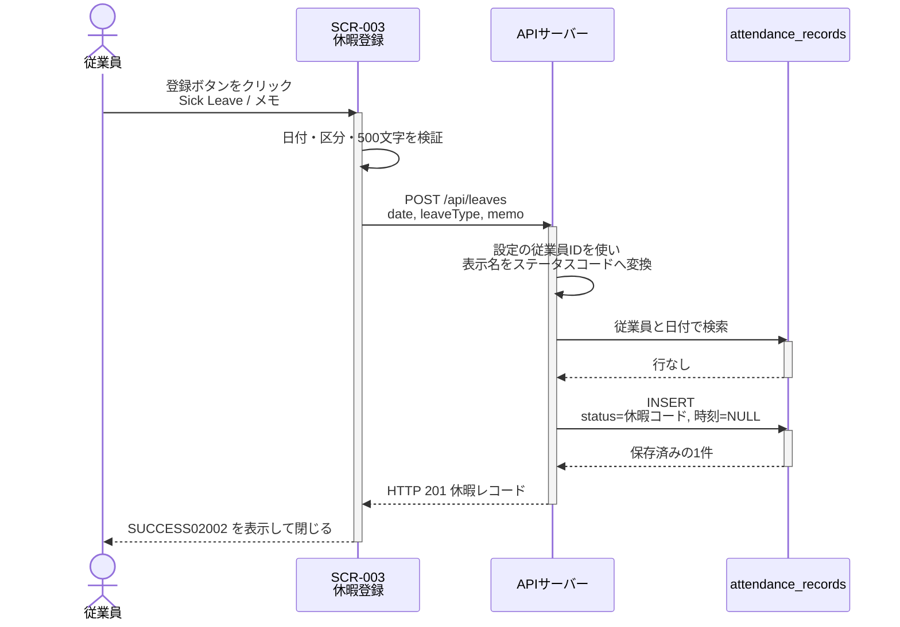
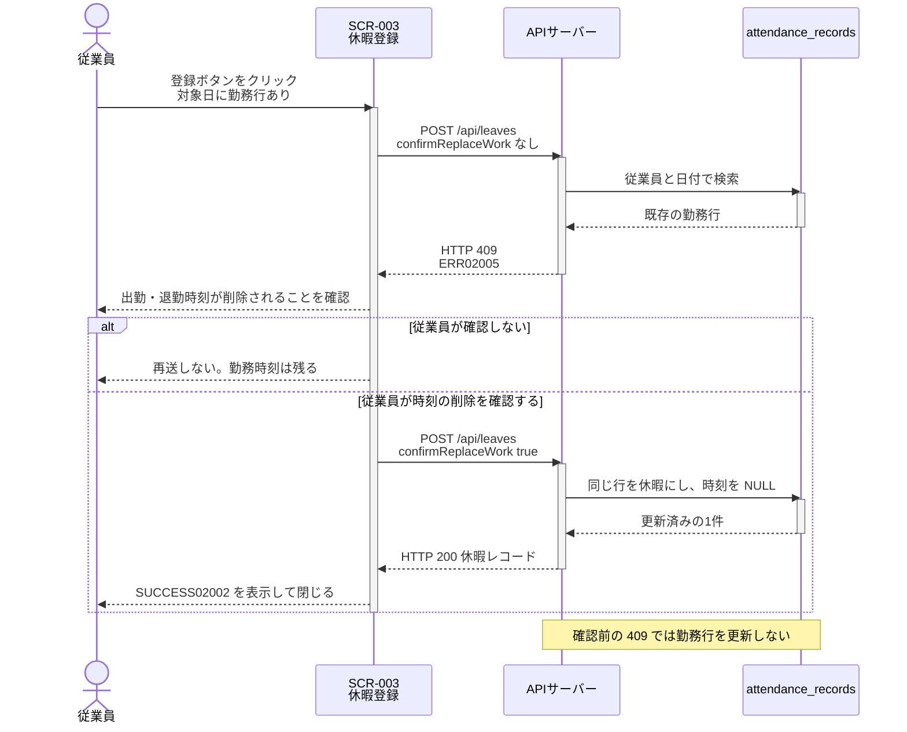
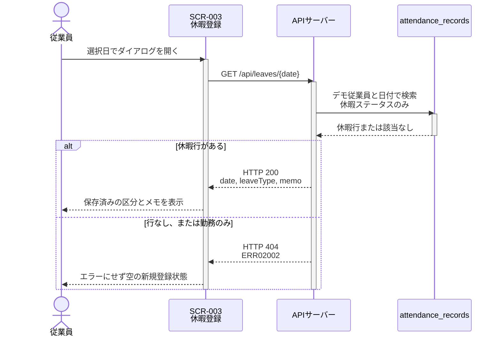
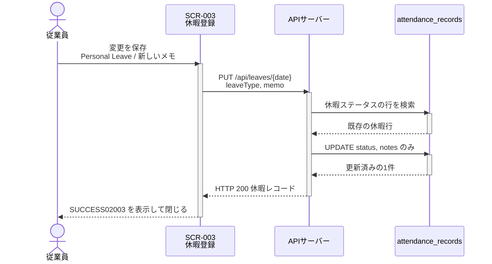
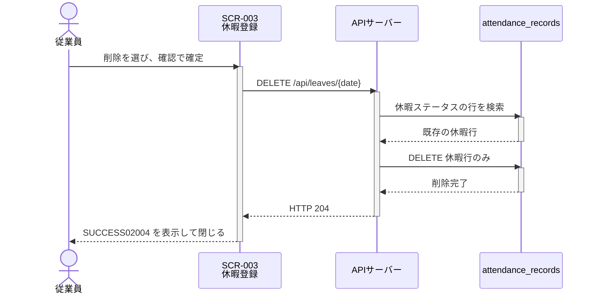

# シーケンス図

システムのコンポーネント間のやり取りを時系列で定義します。

## 命名規則

### シーケンス図ID

- **形式**: `SEQ-UC004-{連番3桁}`
- **命名規則**: REQ-UC004 の操作単位が分かるように命名する

## シーケンス図一覧

| シーケンス図ID | タイトル                 | 概要                                                         | 関連要件  | 関連画面 |
| -------------- | ------------------------ | ------------------------------------------------------------ | --------- | -------- |
| SEQ-UC004-001  | 休暇の新規登録           | 未使用日に休暇を1件作成し、再取得できる内容を返す            | REQ-UC004 | SCR-003  |
| SEQ-UC004-002  | 休暇登録の検証失敗       | 不正な入力や既存休暇を保存せず、勤務日は確認後だけ同じ行を変える | REQ-UC004 | SCR-003  |
| SEQ-UC004-003  | 登録済み休暇の確認       | 選択日の休暇だけを取得し、ダイアログの初期表示に使う         | REQ-UC004 | SCR-003  |
| SEQ-UC004-004  | 登録済み休暇の変更       | 既存の休暇区分とメモだけを更新する。日付と勤務時刻は変えない | REQ-UC004 | SCR-003  |
| SEQ-UC004-005  | 登録済み休暇の削除       | 確認後、休暇行だけを削除する。勤務のみの日は削除しない       | REQ-UC004 | SCR-003  |

---

## シーケンス図詳細

### SEQ-UC004-001: 休暇の新規登録

#### 目的

* 従業員が選択した日付の休暇を1件登録する
* 保存結果を、同じ日付・休暇区分・メモで再取得できる状態にする

#### 範囲

* **トリガー**: 未登録日の SCR-003 で登録ボタンをクリックする
* **含むコンポーネント**: 休暇登録ダイアログ（SCR-003）、`POST /api/leaves`、`attendance_records`
* **除外**: 認証、承認、勤務時間入力（REQ-UC003）、残日数計算

#### 前提条件

* メイン画面（SCR-001）が表示され、日付が選択されている
* 対象日に、デモ従業員の勤怠行がない
* 従業員 ID はサーバー設定（既定 `EMP001`）とする。画面も要求も従業員 ID を送らない

#### 事後条件

* 検証成功時、当該従業員と日付の行が1件増える
* `status` は `SICK_LEAVE`、`PERSONAL_LEAVE`、`BUSINESS_TRIP` のいずれかである
* `clock_in_time` と `clock_out_time` は NULL である
* メモなしは `notes` が NULL である。取得応答の `memo` は空文字である
* 画面は SUCCESS02002 を表示してダイアログを閉じる

#### 基本フロー

1. 従業員が日付を選択し、休暇登録ダイアログを開く
2. ダイアログが選択日の休暇を取得する（SEQ-UC004-003）。404 なら新規登録状態にする
3. 従業員が Sick Leave、Personal Leave、Business Trip のいずれかを選び、必要ならメモを入力する
4. 従業員が登録ボタンをクリックする
5. 画面が日付、区分、500文字以内を検証する
6. 画面が `POST /api/leaves` を呼ぶ。ボディは日付、表示名の休暇区分、任意のメモだけである
7. API がデモ従業員 ID を設定から決め、表示名をステータスコードへ変換する
8. API が従業員と日付で既存行を探す。無ければ休暇行を挿入する
9. API が 201 と休暇レコードを返す
10. 画面が SUCCESS02002 を表示してダイアログを閉じる

#### 代替フロー

* **A1: 検証失敗、既存休暇、または確認なしの勤務日** — SEQ-UC004-002 に従い、確認前は保存しない
* **A4: 勤務日を確認して休暇にする** — 従業員が時刻の削除を確認したあと、`confirmReplaceWork: true` で再送する。API は同じ行の状態を休暇にし、出勤・退勤時刻を空にして 200 を返す。新しい行は作らない
* **A2: 通信失敗** — ERR99002 を表示し、ダイアログは閉じない。入力は保持する
* **A3: キャンセル** — API を呼ばず、入力を破棄してダイアログを閉じる

#### シーケンス図

---

### SEQ-UC004-002: 休暇登録の検証失敗

#### 目的

* 不正な休暇を保存しない
* 既存の休暇行は上書きしない
* 勤務日は、従業員が時刻の削除を確認するまで出勤・退勤時刻を消さない
* 利用者に日本語で修正箇所を伝える

#### 範囲

* **トリガー**: 登録、変更、または削除の操作時に、入力違反、同日競合、対象不存在がある
* **含むコンポーネント**: SCR-003、休暇 API
* **除外**: 成功した書き込み

#### 前提条件

* SCR-003 が開いている

#### 事後条件

* 不正な登録では行を追加しない
* 既存休暇への 409 では休暇行を変えない
* 確認なしの勤務日では出勤・退勤時刻を変えない
* 確認後の勤務日は同じ行を休暇にし、時刻を空にする。2件目は作らない
* 不存在の更新・削除では行を作らず、成功表示を出さない
* 確認前のダイアログは開いたまま、該当メッセージを表示する

#### 基本フロー

1. 従業員が登録、変更の保存、または削除を実行する
2. 画面または API が入力と対象行を検証する
3. 違反がある場合、書き込みをせず ERR03004、ERR03005、ERR03006、ERR03007、ERR02002、または ERR02003 を表示する
4. 従業員が入力を修正できる状態のままダイアログを維持する

#### 代替フロー

* **A1: 画面で不足や上限超過を検出** — API を呼ばずに ERR03004、ERR03005、または ERR03007 を表示する
* **A2: 未対応の休暇区分** — API が 400 と ERR03006 を返す。行は更新されない
* **A3: 同日に休暇がある** — API が 409 と ERR02003 を返す。既存の休暇行は保持する
* **A4: 同日に勤務があり、確認していない** — API が 409 と ERR02005 を返す。時刻は残す。従業員が確認したときだけ `confirmReplaceWork: true` で再送し、同じ行を休暇にする
* **A4: 更新または削除の対象がない** — API が 404 と ERR02002 を返す。成功表示は出さない

#### シーケンス図

---

### SEQ-UC004-003: 登録済み休暇の確認

#### 目的

* 指定日の休暇を1件取得する
* ダイアログの初期表示と、保存後の確認に使う

#### 範囲

* **トリガー**: SCR-003 を開く、または保存結果を確認する
* **含むコンポーネント**: SCR-003、`GET /api/leaves/{date}`、`attendance_records`
* **除外**: 勤務時間ダイアログの `GET /api/attendance/{employeeId}/{date}`

#### 前提条件

* 日付が決まっている
* 日付は未来日でもよい
* 従業員 ID はサーバー設定だけが決める

#### 事後条件

* 休暇ステータスの行がある場合、日付、表示名の休暇区分、メモを返す
* 行がない、または勤務のみの場合、404 と ERR02002 を返す
* ダイアログ初期表示の 404 はエラーにせず、空の新規登録状態にする

#### 基本フロー

1. ダイアログを開く、または再取得が必要になる
2. 画面が `GET /api/leaves/{date}` を呼ぶ。従業員 ID は送らない
3. API がデモ従業員と日付で1件検索する
4. ステータスが休暇コードなら 200 を返す。メモなしは空文字にする
5. 画面は 200 なら区分とメモを初期表示し、登録済み状態にする

#### 代替フロー

* **A1: 休暇がない** — 404 を返す。初期表示では ERR02002 を出さず、区分とメモを空にする
* **A2: 通信失敗** — ERR99002 を表示する。未登録状態と混同せず、登録・変更・削除を実行させない

#### シーケンス図

---

### SEQ-UC004-004: 登録済み休暇の変更

#### 目的

* 既存の休暇区分またはメモを変更する
* 休暇日と勤務時刻は変更しない

#### 範囲

* **トリガー**: 登録済み状態の SCR-003 で変更を保存する
* **含むコンポーネント**: SCR-003、`PUT /api/leaves/{date}`、`attendance_records`
* **除外**: 新規作成、日付の変更、勤務時間の更新

#### 前提条件

* 対象日に休暇ステータスの行がある
* ダイアログは SEQ-UC004-003 で登録済み状態になっている

#### 事後条件

* `status` と `notes` だけが変わる
* `attendance_date`、`employee_id`、出勤・退勤時刻は変わらない
* 対象がない場合は行を作らず 404 とする
* 成功時は SUCCESS02003 を表示してダイアログを閉じる

#### 基本フロー

1. 従業員が区分またはメモを変更する
2. 従業員が変更を保存する
3. 画面が区分と500文字以内を検証する
4. 画面が `PUT /api/leaves/{date}` を呼ぶ。ボディに日付は含めない
5. API が休暇行だけを更新する
6. API が 200 と変更後の休暇レコードを返す
7. 画面が SUCCESS02003 を表示してダイアログを閉じる

#### 代替フロー

* **A1: 対象が休暇でない、または存在しない** — 404 と ERR02002 を返し、成功表示を出さない
* **A2: 区分またはメモが不正** — 400 を返し、行は更新しない
* **A3: キャンセル** — API を呼ばず、未保存の変更を破棄する

#### シーケンス図

---

### SEQ-UC004-005: 登録済み休暇の削除

#### 目的

* 不要になった休暇行を削除する
* 勤務のみの日は削除しない

#### 範囲

* **トリガー**: 登録済み状態で削除を選び、確認ダイアログで確定する
* **含むコンポーネント**: SCR-003、確認ダイアログ、`DELETE /api/leaves/{date}`、`attendance_records`
* **除外**: 勤務時間行の削除、物理削除以外の論理削除

#### 前提条件

* 対象日に休暇ステータスの行がある
* 従業員が削除確認で確定している

#### 事後条件

* 休暇行が削除される
* 同じ日付の再取得は 404 になり、架空の休暇は表示されない
* 勤務のみの日、または対象がない日は 404 とし、行を削除しない
* 成功時は SUCCESS02004 を表示してダイアログを閉じる
* 削除後の同じ日付へは、SEQ-UC004-001 で新しい休暇を登録できる

#### 基本フロー

1. 従業員が削除を選ぶ
2. 画面が確認ダイアログを表示する。確定前は API を呼ばない
3. 従業員が削除を確定する
4. 画面が `DELETE /api/leaves/{date}` を呼ぶ
5. API が休暇ステータスの行だけを削除する
6. API が 204 を返す
7. 画面が SUCCESS02004 を表示してダイアログを閉じる

#### 代替フロー

* **A1: 確認を取り消す** — API を呼ばず、休暇行は残す
* **A2: 対象がない、または勤務のみ** — 404 と ERR02002 を返す。成功表示は出さない
* **A3: 通信失敗** — ERR99002 を表示し、削除済みとは扱わない

#### シーケンス図

