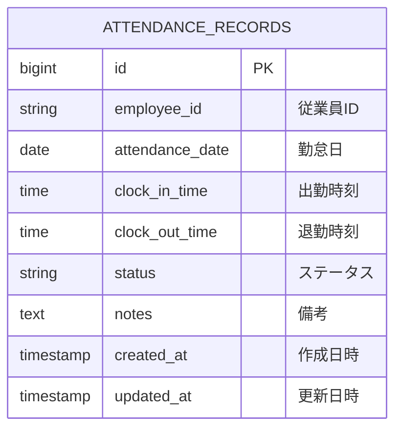

# テーブル定義書

システムのデータベーステーブル定義を管理します。

## 命名規則

### テーブル名

- **形式**: 小文字スネークケース (例: `favorites`, `product_reviews`)
- **複数形**: 原則として複数形を使用
- **命名規則**: ビジネス用語を使用、省略形は避ける

---

## ハイレベル設計

### エンティティ一覧

| 項番 | データベース  | 論理エンティティ名                                | 物理エンティティ名 | 備考                 |
| ---- | ------------- | ------------------------------------------------- | ------------------ | -------------------- |
| 1    | attendance_db | [勤怠レコード](#1-勤怠レコードattendance_records) | attendance_records | 従業員の日次勤怠情報 |

### ER図



REQ-UC004では既存の`attendance_records`エンティティを使用し、`status`の値を拡張します。新しいエンティティ、カラム、テーブル間のリレーションは追加しないため、エンティティ一覧とER図の構造は変更しません。

---

## ローレベル設計

### テーブル詳細定義

#### 1. 勤怠レコード（`attendance_records`）

**テーブル概要**:
- 従業員の日次勤怠情報を管理するメインテーブル
- 出勤・退勤時刻、休暇情報、勤怠ステータスを記録
- 関連要件: REQ-UC001（システム起動）, REQ-UC002（カレンダー操作）, REQ-UC003（勤務時間入力）, REQ-UC004（休暇登録）

**テーブル構造**:

| カラム名        | 論理名     | データ型    | Not Null | 既定値            | 説明                                                                                      |
| --------------- | ---------- | ----------- | -------- | ----------------- | ----------------------------------------------------------------------------------------- |
| id              | ID         | BIGSERIAL   | ✓        | 自動採番          | 勤怠レコードの一意識別子（主キー、PostgreSQLのシーケンス）                                |
| employee_id     | 従業員ID   | VARCHAR(50) | ✓        | -                 | 従業員を識別するID<br/>例: "EMP001"                                                       |
| attendance_date | 勤怠日     | DATE        | ✓        | -                 | 勤怠記録の対象日<br/>形式: YYYY-MM-DD                                                     |
| clock_in_time   | 出勤時刻   | TIME        |          | NULL              | 出勤時刻<br/>形式: HH:MM:SS<br/>休暇の場合はNULL                                          |
| clock_out_time  | 退勤時刻   | TIME        |          | NULL              | 退勤時刻<br/>形式: HH:MM:SS<br/>休暇の場合はNULL                                          |
| status          | ステータス | VARCHAR(20) | ✓        | 'WORK'            | 勤怠ステータス<br/>値: 'WORK'（出勤）, 'PAID_LEAVE'（有給休暇）, 'SICK_LEAVE'（病欠）, 'UNPAID_LEAVE'（無給休暇）, 'PERSONAL_LEAVE'（私用休暇）, 'BUSINESS_TRIP'（出張） |
| notes           | 備考       | TEXT        |          | NULL              | 勤怠に関する追加情報やメモ<br/>最大長: 制限なし                                           |
| created_at      | 作成日時   | TIMESTAMP   | ✓        | CURRENT_TIMESTAMP | レコード作成日時<br/>自動設定                                                             |
| updated_at      | 更新日時   | TIMESTAMP   | ✓        | CURRENT_TIMESTAMP | レコード最終更新日時<br/>更新時に自動更新                                                 |

**制約・キー**:

##### 主キー (Primary Key)

| 制約名                | カラム | 説明                     |
| --------------------- | ------ | ------------------------ |
| pk_attendance_records | id     | 勤怠レコードの一意識別子 |

##### 一意キー (Unique Key)

| 制約名                      | カラム                       | 説明                                                   |
| --------------------------- | ---------------------------- | ------------------------------------------------------ |
| uk_attendance_employee_date | employee_id, attendance_date | 同じ従業員の同じ日付に複数の勤怠レコードを作成できない |

##### チェック制約 (Check Constraint)

| 制約名                     | 条件                                                                               | 説明                                   |
| -------------------------- | ---------------------------------------------------------------------------------- | -------------------------------------- |
| chk_attendance_status      | status IN ('WORK', 'PAID_LEAVE', 'SICK_LEAVE', 'UNPAID_LEAVE', 'PERSONAL_LEAVE', 'BUSINESS_TRIP') | ステータスは定義された値のみ許可 |
| chk_attendance_clock_times | clock_out_time IS NULL OR clock_in_time IS NULL OR clock_out_time > clock_in_time | 出勤時刻が退勤時刻より前であること     |
| chk_attendance_work_times  | status <> 'WORK' OR (clock_in_time IS NOT NULL AND clock_out_time IS NOT NULL)     | 出勤レコードでは出勤・退勤時刻を必須とする |
| chk_attendance_leave_times | status NOT IN ('PAID_LEAVE', 'SICK_LEAVE', 'UNPAID_LEAVE', 'PERSONAL_LEAVE', 'BUSINESS_TRIP') OR (clock_in_time IS NULL AND clock_out_time IS NULL) | 休暇レコードでは出勤・退勤時刻をNULLとする |

##### インデックス (Index)

| インデックス名               | カラム                       | 種別   | 説明 |
| ---------------------------- | ---------------------------- | ------ | ---- |
| uk_attendance_employee_date  | employee_id, attendance_date | Unique | 一意制約により自動作成され、UC003/UC004の日付別検索・登録／更新・削除に使用。重複する別インデックスは作成しない |

**カラム詳細説明**:

##### `status`（ステータス）の値定義

| 値              | 説明         | clock_in_time | clock_out_time | 備考 |
| --------------- | ------------ | ------------- | -------------- | ---- |
| WORK            | 出勤         | 必須          | 必須           | 通常の勤務日 |
| PAID_LEAVE      | 有給休暇     | NULL          | NULL           | 既存ステータス。有給休暇取得日 |
| SICK_LEAVE      | 病欠         | NULL          | NULL           | UC004: Sick Leave |
| UNPAID_LEAVE    | 無給休暇     | NULL          | NULL           | 既存ステータス。無給の休暇 |
| PERSONAL_LEAVE  | 私用休暇     | NULL          | NULL           | UC004: Personal Leave |
| BUSINESS_TRIP   | 出張         | NULL          | NULL           | UC004: Business Trip |

**データ例**:

```sql
-- 通常の出勤
INSERT INTO attendance_records (employee_id, attendance_date, clock_in_time, clock_out_time, status, notes)
VALUES ('EMP001', '2024-11-18', '09:00:00', '18:00:00', 'WORK', NULL);

-- 有給休暇
INSERT INTO attendance_records (employee_id, attendance_date, clock_in_time, clock_out_time, status, notes)
VALUES ('EMP001', '2024-11-19', NULL, NULL, 'PAID_LEAVE', '家族旅行');

-- 病欠
INSERT INTO attendance_records (employee_id, attendance_date, clock_in_time, clock_out_time, status, notes)
VALUES ('EMP001', '2024-11-20', NULL, NULL, 'SICK_LEAVE', '風邪のため');

-- 私用休暇
INSERT INTO attendance_records (employee_id, attendance_date, clock_in_time, clock_out_time, status, notes)
VALUES ('EMP001', '2024-11-21', NULL, NULL, 'PERSONAL_LEAVE', '私用のため休暇');

-- 出張
INSERT INTO attendance_records (employee_id, attendance_date, clock_in_time, clock_out_time, status, notes)
VALUES ('EMP001', '2024-11-22', NULL, NULL, 'BUSINESS_TRIP', '出張のため不在');
```

**関連要件とテーブル利用**:

| 要件      | 操作          | 説明                                                                                   |
| --------- | ------------- | -------------------------------------------------------------------------------------- |
| REQ-UC001 | -             | システム起動時はテーブルにアクセスしない（画面表示のみ）                               |
| REQ-UC002 | SELECT        | カレンダー操作は現在フロントエンドのみで完結。将来的に勤怠データを取得して表示する予定 |
| REQ-UC003 | INSERT/UPDATE | 勤務時間入力時にレコードを作成または更新                                               |
| REQ-UC004 | SELECT/INSERT/UPDATE/DELETE | 休暇レコードの取得、登録・更新、確認後の削除 |

**REQ-UC003（勤務時間入力）の詳細**:

| API／画面データ | `attendance_records` のカラム | 保存・取得ルール |
| --------------- | ----------------------------- | --------------- |
| 従業員ID | `employee_id` | 保存と検索に使用。現行は `EMP001`。 |
| 選択日（`YYYY-MM-DD`） | `attendance_date` | 保存と検索に使用。未来日付も許可し、日付範囲の制約は設けない。 |
| 出勤時刻（`HH:MM`） | `clock_in_time` | `TIME`型で保存。画面・保存APIでは分単位で扱い、取得時に秒を画面表示しない。 |
| 退勤時刻（`HH:MM`） | `clock_out_time` | `TIME`型で保存。`clock_in_time`より後であること。 |
| 勤怠ステータス | `status` | 勤務時間入力では `WORK` を保存する。 |

**REQ-UC004（休暇登録）の詳細**:

| API／画面データ | `attendance_records` のカラム | 保存・取得ルール |
| --------------- | ----------------------------- | --------------- |
| 従業員ID | `employee_id` | 保存、取得、削除の条件に使用。現行は `EMP001`。 |
| 選択日（`YYYY-MM-DD`） | `attendance_date` | 保存、取得、削除の条件に使用。未来日付を許可し、日付範囲の制約は設けない。 |
| 休暇区分 `Sick Leave` | `status` | `SICK_LEAVE` として保存する。 |
| 休暇区分 `Personal Leave` | `status` | `PERSONAL_LEAVE` として保存する。 |
| 休暇区分 `Business Trip` | `status` | `BUSINESS_TRIP` として保存する。 |
| 出勤時刻・退勤時刻 | `clock_in_time`, `clock_out_time` | 休暇レコードでは両方 `NULL` とする。 |
| 任意メモ | `notes` | 入力値を保存する。未入力の場合は `NULL` とする。 |

休暇区分の表示名とDB値の対応は、画面・API・DBで共通とします。既存の`PAID_LEAVE`と`UNPAID_LEAVE`は既存機能との互換性のため保持し、UC004の3つの選択肢には含めません。

休暇登録時、同一従業員・同一日に既存の`WORK`またはUC004対象外ステータスのレコードがある場合は、既存行を置き換えず処理を拒否してAPIが`409 Conflict`を返します。既存のUC004対象休暇レコードは更新できます。

**整合性・アクセスルール**:

- `WORK` のレコードは `clock_in_time` と `clock_out_time` の両方を必須とし、`clock_out_time > clock_in_time` を満たすこと。これらの条件に違反する登録・更新は拒否し、同一トランザクション内の変更をロールバックする。
- `PAID_LEAVE`、`SICK_LEAVE`、`UNPAID_LEAVE`、`PERSONAL_LEAVE`、`BUSINESS_TRIP` の休暇レコードでは、`clock_in_time` と `clock_out_time` を両方 `NULL` とする。`chk_attendance_leave_times`でDB側でも保証する。
- `uk_attendance_employee_date` により、同じ従業員・勤怠日のレコードは一件に限定する。保存処理はこの組み合わせをキーに既存行を更新し、未登録の場合は新規行を作成する。
- 特定日の取得は `employee_id` と `attendance_date` の完全一致で検索する。該当行がない場合はAPIが `404` を返し、DB上の行は作成しない。
- 複合一意キーはUC003の取得・保存対象の検索にも使用する。登録・更新は `attendance_records` の一行を対象とし、他の日付のレコードを変更しない。
- UC004の登録・更新は `employee_id` と `attendance_date` をキーに一行を対象とし、休暇ステータスとメモを保存する。既存のUC004対象休暇レコードは更新し、未登録の場合は新規行を作成する。既存レコードのステータスが`WORK`またはUC004対象外の場合は既存データを変更せず、APIは`409 Conflict`を返す。ステータス確認と保存は同一トランザクション内で行う。
- UC004の削除は `employee_id` と `attendance_date` に一致するレコード一行に限定し、対象ステータスがUC004の休暇区分であることを確認してから削除する。該当レコードがない場合は`404`、対象ステータスがUC004の休暇区分でない場合は`409 Conflict`を返し、行を変更しない。対象ステータスの確認と削除は同一トランザクション内で行う。
- UC004の取得・登録／更新・削除はいずれも `uk_attendance_employee_date` を利用するため、専用の追加インデックスは作成しない。

**REQ-UC002（カレンダー操作）の詳細**:

現在の実装では、カレンダーの日付選択と月切り替えはフロントエンド側の状態管理のみで実現されており、データベースへのアクセスは発生しません。

将来の拡張として、以下のクエリパターンが想定されます:

```sql
-- 従業員の勤怠レコード一覧を取得（カレンダーに勤怠状態を表示する場合）
SELECT * FROM attendance_records
WHERE employee_id = 'EMP001'
ORDER BY attendance_date DESC;

-- 特定月の勤怠レコードを取得
SELECT * FROM attendance_records
WHERE employee_id = 'EMP001'
  AND attendance_date >= '2024-11-01'
  AND attendance_date <= '2024-11-30'
ORDER BY attendance_date ASC;

-- 特定日の勤怠レコードを取得
SELECT * FROM attendance_records
WHERE employee_id = 'EMP001'
  AND attendance_date = '2024-11-18';
```

これらのクエリは、複合一意制約のインデックス（`uk_attendance_employee_date`）により効率的に実行されます。従業員IDを先頭列とするため、従業員ID単独の検索にも利用できます。日付単独の検索要件が追加された場合は、実行計画を確認したうえで専用インデックスを検討します。

**備考**:

- `employee_id`は将来的に従業員マスターテーブルの外部キーとなる予定
- `created_at`と`updated_at`はデータベーストリガーまたはJPAの`@CreatedDate`、`@LastModifiedDate`アノテーションで自動設定
- ハイレベル設計ではエンティティを`attendance_records`一つとし、UC004のための新規テーブルやリレーションは追加しない。
- 新規DBのテーブル作成DDLは`backend/init-db/01-schema.sql`に定義し、UC004のステータス値と休暇時刻制約を反映する。
- 既存DBは初期化DDLが再実行されないため、既存データ向けには`backend/migrations/002_attendance_leave_statuses.sql`を適用する。不正な既存データがある場合は移行を中断し、データを自動補完しない。
