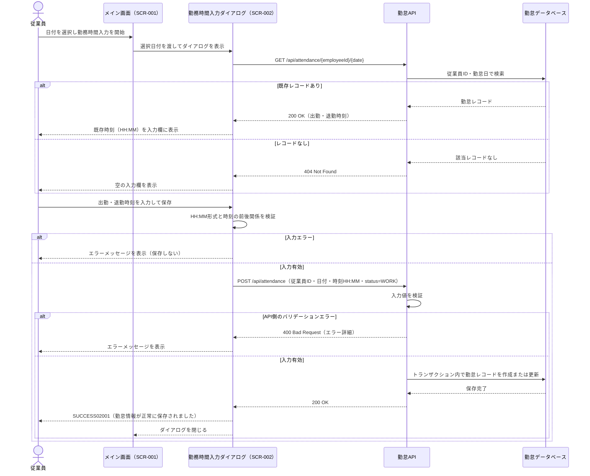

# 勤務時間入力シーケンス図

## 目次

- [SEQ-UC003-001: 勤務時間の登録・更新](#seq-uc003-001-勤務時間の登録更新)

## 関連ドキュメント

- [REQ-UC003 勤務時間入力](../../../requirements/REQ-UC003-勤務時間入力.md)
- [E2E仕様 REQ-UC003 勤務時間入力](../../../../e2e/features/REQ-UC003-勤務時間入力.feature)
- [画面設計書 SCR-002](../../screen-design.md#scr-002-勤務時間入力フォーム)
- [API設計書](../../openapi.yaml)
- [テーブル定義書 attendance_records](../../database-table-definitions.md)

---

### SEQ-UC003-001: 勤務時間の登録・更新

#### 目的

* 従業員が選択した日付の出勤時刻・退勤時刻を検証し、勤怠レコードを登録または更新する
* 入力エラー時は勤怠情報を保存せず、エラーを表示する

#### 範囲

* **トリガー**: 従業員がメイン画面（SCR-001）で選択日付の「勤務時間入力」を開始する
* **含むコンポーネント**: 従業員、勤務時間入力ダイアログ（SCR-002）、Reactフロントエンド、勤怠API、勤怠データベース
* **除外**: 認証・従業員IDの特定（現行設計では従業員IDに `EMP001` を使用）、休暇登録

#### 前提条件

* 従業員がシステムにアクセスし、メイン画面（SCR-001）が表示されている
* 勤務時間を登録または更新する日付が選択されている

#### 事後条件

* 入力が有効な場合、従業員と勤怠日の組み合わせにつき1件の勤怠レコードが保存される
* 入力が無効な場合、勤怠レコードは変更されず、入力エラーが表示される

#### 基本フロー

1. 従業員が選択日付の「勤務時間入力」を開始する
2. フロントエンドが勤務時間入力ダイアログ（SCR-002）を表示する
3. フロントエンドが `GET /api/attendance/{employeeId}/{date}` で選択日の勤怠レコードを取得する
4. 勤怠APIが勤怠データベースを検索する。`200` の場合は既存の出勤・退勤時刻（HH:MM:SS形式）を返し、フロントエンドは入力欄にHH:MM形式で表示する。`404` の場合は空の入力欄を表示する
5. 従業員が出勤時刻と退勤時刻を入力し、保存ボタンをクリックする
6. フロントエンドが時刻の形式（HH:MM）と出勤時刻が退勤時刻より前であることを検証する
7. フロントエンドが `POST /api/attendance` で従業員ID、勤怠日、出勤時刻、退勤時刻（HH:MM形式）、ステータス `WORK` を送信する
8. 勤怠APIが入力値を検証し、従業員IDと勤怠日の組み合わせに対応する勤怠レコードをトランザクション内で新規作成または更新する
9. 勤怠データベースが保存を完了し、勤怠APIが成功レスポンスを返す
10. フロントエンドが `SUCCESS02001`（「勤怠情報が正常に保存されました」）を表示してダイアログを閉じ、従業員がメイン画面に戻る

#### 代替フロー

* **A1: 時刻形式が無効** — 手順6で `ERR03002`（「有効な時刻形式で入力してください」）を表示し、保存APIを呼び出さない。勤怠情報は保存しない。
* **A2: 出勤時刻が退勤時刻以降** — 手順6で `ERR03001`（「出勤時刻は退勤時刻より前である必要があります」）を表示し、保存APIを呼び出さない。勤怠情報は保存しない。
* **A3: API側のバリデーションエラー** — 手順8で勤怠APIが `400` と `ErrorResponse` を返す。フロントエンドはレスポンスのメッセージを表示し、ダイアログを維持する。
* **A4: 未来日付を選択** — 日付を理由とするエラーにはせず、基本フローと同様に登録または更新する。

#### シーケンス図

