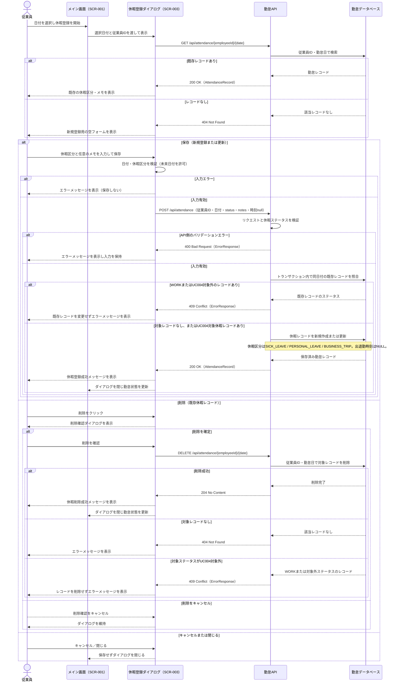

# 休暇登録シーケンス図

## 目次

- [SEQ-UC004-001: 休暇の登録・更新・削除](#seq-uc004-001-休暇の登録更新削除)

## 関連ドキュメント

- [REQ-UC004 休暇登録](../../../requirements/REQ-UC004-休暇登録.md)
- [E2E仕様 REQ-UC004 休暇登録](../../../../e2e/features/REQ-UC004-休暇登録.feature)
- [画面設計書 SCR-003](../../screen-design.md#scr-003-休暇登録フォーム)
- [API設計書](../../openapi.yaml)
- [テーブル定義書 attendance_records](../../database-table-definitions.md)
- [メッセージ定義書](../../message-definition.md)

---

### SEQ-UC004-001: 休暇の登録・更新・削除

#### 目的

* 従業員が選択した日付に休暇を登録し、同じ従業員・日付の既存レコードがあれば更新する
* 既存の休暇レコードを取得・削除し、処理結果を画面に表示する
* 入力またはAPIでエラーが発生した場合、エラーを表示して入力内容を保持する

#### 範囲

* **トリガー**: 従業員がメイン画面（SCR-001）で日付を選択し、「休暇登録」を開始する
* **含むコンポーネント**: 従業員、メイン画面（SCR-001）、休暇登録ダイアログ（SCR-003）、勤怠API、勤怠データベース（`attendance_records`）
* **除外**: 認証・従業員IDの特定（現行設計では従業員IDに `EMP001` を使用）

#### 前提条件

* 従業員がシステムにアクセスし、メイン画面（SCR-001）が表示されている
* 休暇を登録または更新する日付が選択されている

#### 事後条件

* 保存が成功した場合、従業員と勤怠日の組み合わせにつき1件の休暇レコードが保存され、勤怠ステータスに休暇区分が設定される
* 削除が成功した場合、対象の休暇レコードが削除される
* 保存・削除が失敗した場合、データは変更されず、ダイアログにエラーが表示される

#### 基本フロー

1. 従業員がSCR-001で日付を選択し、「休暇登録」を開始する
2. フロントエンドが選択日付を渡して休暇登録ダイアログ（SCR-003）を表示する
3. フロントエンドが `GET /api/attendance/{employeeId}/{date}` で選択日の勤怠レコードを取得する
4. レコードがある場合、APIは `200` と既存レコードを返し、フロントエンドは休暇区分とメモをフォームに表示する。レコードがない場合、APIは `404` を返し、フロントエンドは新規登録用の空のフォームを表示する
5. 従業員が休暇区分（Sick Leave、Personal Leave、Business Trip）を選択し、必要に応じてメモを入力して保存する
6. フロントエンドが日付と休暇区分を検証する。未来日付は許可し、メモは未入力でも保存できる
7. フロントエンドが `POST /api/attendance` で従業員ID、勤怠日、休暇ステータス、メモを送信する。出勤・退勤時刻は `null` とする
8. APIがリクエストを検証し、従業員IDと勤怠日の組み合わせをキーにトランザクション内で勤怠レコードを新規作成または更新する
9. データベースが保存を完了し、APIが `200` と保存済みレコードを返す
10. フロントエンドが休暇登録成功メッセージを表示してダイアログを閉じ、SCR-001に戻る

#### 代替フロー

* **A1: 既存レコードなし** — 手順4で `404` を受け取った場合、新規登録用の空のフォームを表示する。これは新規登録時の正常な分岐である。
* **A2: 既存休暇レコードを更新** — 手順4で休暇レコードを取得した場合、既存値を表示する。従業員が値を変更して保存すると、手順7以降で同じ従業員・勤怠日のレコードを更新する。
* **A3: 入力値が無効** — 手順6で日付または休暇区分が無効な場合、該当するエラーメッセージを表示し、保存APIを呼び出さない。メモが空であることはエラーにしない。
* **A4: API側のバリデーションエラー** — 手順8でAPIが `400` と `ErrorResponse` を返す。フロントエンドはエラーメッセージを表示し、入力内容を保持したままダイアログを維持する。
* **A5: 未来日付を選択** — 日付を理由とするエラーにはせず、基本フローと同様に登録または更新する。
* **A6: 既存休暇レコードを削除** — 従業員が削除を選択し、確認ダイアログで確定した場合、`DELETE /api/attendance/{employeeId}/{date}` を呼び出す。APIは対象レコードを削除し、成功時は `204` を返す。フロントエンドは削除成功メッセージを表示してダイアログを閉じる。削除確認をキャンセルした場合は、データを変更せずダイアログに戻る。
* **A7: 削除対象が存在しない** — 削除APIが `404` と `ERR02002` を返した場合、削除完了として扱わず、「指定された日付の休暇レコードが見つかりません」を表示してダイアログを維持する。
* **A8: APIまたはネットワークエラー** — 保存・削除APIが失敗した場合、エラーメッセージを表示し、入力内容を保持してダイアログを維持する。
* **A9: 同日付にUC004対象外のレコードが存在** — 休暇の登録・更新時に同一従業員・同一日付の`WORK`またはUC004対象外ステータスのレコードがある場合、APIは `409 Conflict` を返して既存レコードを変更しない。フロントエンドはメッセージを表示し、入力内容を保持する。
* **A10: キャンセルまたは閉じる** — 保存せずにダイアログを閉じ、SCR-001に戻る。

#### シーケンス図

#### 設計上の整合性事項

* 休暇区分は要件に合わせ、APIおよびDBの値を `SICK_LEAVE`、`PERSONAL_LEAVE`、`BUSINESS_TRIP` とする案を採用する。既存のOpenAPIとテーブル定義にあるステータス値・制約は、本図の実装前にこの区分と整合させる必要がある。
* 登録・更新は既存の `POST /api/attendance` の従業員ID＋勤怠日による登録・更新を使用する。
* 同日付に`WORK`またはUC004対象外ステータスのレコードがある場合、休暇の登録・更新は`409 Conflict`で拒否し、既存レコードを保持する。
* 取得は既存の `GET /api/attendance/{employeeId}/{date}` を使用する。登録前の `404` は空フォーム表示の分岐として扱う。
* 削除は `DELETE /api/attendance/{employeeId}/{date}` を使用し、UC004対象外ステータスの場合は`409 Conflict`で拒否する。API設計書の対象ステータス・応答定義と一致させる。
* `attendance_records` の複合一意制約 `uk_attendance_employee_date` により、同一従業員・同一日付の勤怠レコードを1件に限定する。
* 保存成功・削除成功メッセージはUC004用の定義をメッセージ定義書に追加する。現行メッセージ一覧にはUC004固有の成功・削除メッセージは定義されていない。
