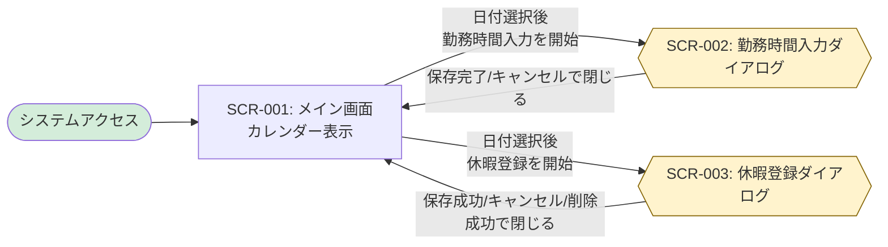

# 画面設計書

ハイレベル設計として画面一覧と画面遷移図を定義し、ローレベル設計として各画面の詳細仕様を記載します。

## 命名規則

### 画面ID

- **形式**: `SCR-{連番3桁}` (例: `SCR-001`)
- **命名規則**: 画面の目的と機能が明確になるように命名

---

## ハイレベル設計

### 画面一覧

| 画面ID  | 画面名               | カテゴリ   | 概要                                           | アクセス権限 | 関連要件     |
| ------- | -------------------- | ---------- | ---------------------------------------------- | ------------ | ------------ |
| SCR-001 | メイン画面           | 勤怠管理   | カレンダーを表示し勤怠操作の起点となる画面     | ACT-001      | UC001, UC002, UC003, UC004 |
| SCR-002 | 勤務時間入力フォーム | ダイアログ | メイン画面上で出勤・退勤時刻を入力するモーダル | ACT-001      | UC003        |
| SCR-003 | 休暇登録フォーム     | ダイアログ | メイン画面上で休暇種別とメモを入力するモーダル | ACT-001      | UC004        |

※ SCR-002 / SCR-003 は独立した画面遷移先ではなく、SCR-001 上で表示される画面内ダイアログとして扱う。

### 画面遷移図



---

## ローレベル設計

<!-- TODO: ローレベル設計フェーズで各画面の詳細仕様を記載します -->
<!-- 以下のセクションはローレベル設計時に具体化します -->

### 画面詳細定義

#### SCR-001: メイン画面

**関連要件**: REQ-UC001（システム起動）, REQ-UC002（カレンダー操作）, REQ-UC003（勤務時間入力の開始）, REQ-UC004（休暇登録の開始）

**画面概要**:
- カレンダーベースのUIで勤怠管理のメイン画面として機能
- 従業員が日付を選択して勤務時間入力や休暇登録を行うための起点となる
- システム起動時に最初に表示される画面

**アクセス権限**: ACT-001（従業員）

**画面構成**:

```
┌─────────────────────────────────────────────────────────┐
│ 勤怠管理システム                                        │
├─────────────────────────────────────────────────────────┤
│                                                         │
│  ┌───────────────────────────────────────────────────┐ │
│  │          2024年 11月                   < >        │ │
│  ├───────────────────────────────────────────────────┤ │
│  │  日  月  火  水  木  金  土                        │ │
│  ├───────────────────────────────────────────────────┤ │
│  │           1   2   3   4   5                       │ │
│  │   6   7   8   9  10  11  12                       │ │
│  │  13  14  15  16  17  18  19                       │ │
│  │  20  21  22  23  24  25  26                       │ │
│  │  27  28  29  30                                   │ │
│  └───────────────────────────────────────────────────┘ │
│                                                         │
└─────────────────────────────────────────────────────────┘
```

**画面項目**:

| 項目ID   | 項目名             | 種別       | 必須 | 既定値 | 説明                                                         | バリデーション |
| -------- | ------------------ | ---------- | ---- | ------ | ------------------------------------------------------------ | -------------- |
| SCR001-1 | 画面タイトル       | 表示       | -    | -      | 「勤怠管理システム」を表示                                   | -              |
| SCR001-2 | 年月表示           | ボタン     | -    | 現在月 | 現在表示中のカレンダーの年月を表示<br/>形式: 「YYYY年 MM月」。クリックで年月選択モーダルを開く | -              |
| SCR001-3 | 前月ボタン         | ボタン     | -    | -      | クリックで前月のカレンダーを表示                             | -              |
| SCR001-4 | 次月ボタン         | ボタン     | -    | -      | クリックで次月のカレンダーを表示                             | -              |
| SCR001-5 | 曜日ヘッダー       | 表示       | -    | -      | 日曜日から土曜日までの曜日を表示                             | -              |
| SCR001-6 | 日付セル           | クリック可 | -    | -      | カレンダーの各日付を表示<br/>クリックで日付を選択            | -              |
| SCR001-7 | カレンダーグリッド | 表示領域   | -    | -      | 月のすべての日付を7列×最大6行のグリッドで表示                | -              |
| SCR001-8 | 年月選択モーダル   | ダイアログ | -    | 非表示 | 年と月を選択し、表示するカレンダー年月を直接指定             | -              |

**画面項目の詳細**:

##### SCR001-6: 日付セル

各日付セルは以下の状態を持つ:
- **当月の日付**: 通常表示、クリック可能
- **前月/翌月の日付**: グレーアウト表示（オプション）
- **本日**: ハイライト表示（例: 太枠または特別な背景色）
- **選択中の日付**: 強調表示（例: 青色背景）
- **土日**: 直感的な色分けで背景・文字色を変更（例: 日曜は`#fdecea` + `#c62828`、土曜は `#e8f1ff` + `#1565c0`）。本日/選択状態より優先度は低く、それらに該当する場合は本日/選択のスタイルを適用する。

日付セルの操作:
- **クリック時の動作** (REQ-UC002):
  1. クリックされた日付を選択状態にする
  2. 以前に選択されていた日付のハイライトを解除する
  3. 新しく選択された日付をハイライト表示する
  4. 選択日付に応じた操作オプション（「勤務時間入力」「休暇登録」ボタン等）を表示する
- **ホバー時の動作**: 日付セルの背景色を変更し、クリック可能であることを示す
- **日付選択の保持**: 選択された日付はReactのステート（`selectedDate`）に保存される

日付セルをクリックすると、日付選択とハイライト表示を行います。日付セルのクリックだけではダイアログを開きません。選択後に表示される「勤務時間入力」または「休暇登録」操作ボタンから、それぞれSCR-002またはSCR-003をメイン画面上のモーダルダイアログとして開きます。

##### SCR001-3: 前月ボタン

**操作** (REQ-UC002):
1. クリック時、表示中のカレンダーを前月に切り替える
2. 年月表示を更新する（例: 「2024年 12月」→「2024年 11月」）
3. 年をまたぐ場合も適切に処理する（例: 「2025年 1月」→「2024年 12月」）
4. カレンダーグリッドを前月の日付で再レンダリングする

**状態管理**: Reactのステート（`currentMonth`）を更新

##### SCR001-4: 次月ボタン

**操作** (REQ-UC002):
1. クリック時、表示中のカレンダーを次月に切り替える
2. 年月表示を更新する（例: 「2024年 11月」→「2024年 12月」）
3. 年をまたぐ場合も適切に処理する（例: 「2024年 12月」→「2025年 1月」）
4. カレンダーグリッドを次月の日付で再レンダリングする

**状態管理**: Reactのステート（`currentMonth`）を更新

##### SCR001-2: 年月表示

**表示形式**: 「YYYY年 MM月」（例: 「2024年 11月」）

**更新タイミング** (REQ-UC002):
- 前月ボタンまたは次月ボタンをクリックした際に自動更新される
- 年月選択モーダルで年月を確定した際に自動更新される
- 表示月の変更に連動して即座に反映される

**状態管理**: Reactのステート（`currentMonth`）から生成

##### SCR001-8: 年月選択モーダル

- 年月表示を起動ボタンとして操作すると、モーダルを開く
- 初期値は現在表示中の年月とする
- 年は1900〜2100年、月は1〜12月から選択できる
- 「確定」で指定年月を表示するカレンダーに切り替えてモーダルを閉じる
- 「キャンセル」またはEscapeキーで、表示年月を変更せずモーダルを閉じる
- キーボードで操作でき、モーダルを閉じた後は起動ボタンへフォーカスを戻す

**呼び出すAPI**:

| 操作                       | メソッド | エンドポイント                 | 説明                                                     | 関連要件  |
| -------------------------- | -------- | ------------------------------ | -------------------------------------------------------- | --------- |
| カレンダー初期表示         | -        | -                              | APIは使用しない（フロントエンド側で生成）                | UC001     |
| 勤怠データ取得（将来実装） | GET      | `/api/attendance/{employeeId}` | 従業員の勤怠レコード一覧を取得（カレンダーに状態を表示） | UC002以降 |

※ REQ-UC002（カレンダー操作）では、日付選択や月切り替えはフロントエンド側の状態管理のみで実現し、バックエンドAPIは呼び出しません。

**画面遷移・画面内状態変化**:

| トリガー             | 遷移先画面                      | 条件                                             | 関連要件     |
| -------------------- | ------------------------------- | ------------------------------------------------ | ------------ |
| システムURL アクセス | 本画面（SCR-001）               | システム起動時の初期画面                         | UC001        |
| 前月ボタン クリック  | 本画面（SCR-001）               | カレンダー表示を前月に更新（遷移なし）           | UC002        |
| 次月ボタン クリック  | 本画面（SCR-001）               | カレンダー表示を次月に更新（遷移なし）           | UC002        |
| 日付セル クリック    | 本画面（SCR-001）               | 日付選択状態を更新（遷移なし）                   | UC002        |
| 「勤務時間入力」クリック | 勤務時間入力フォーム（SCR-002） | 日付選択後、勤務時間入力ダイアログを表示             | UC003        |
| 「休暇登録」クリック     | 休暇登録フォーム（SCR-003）     | 日付選択後、休暇登録ダイアログを表示                 | UC004        |
| ダイアログ操作成功等     | 本画面（SCR-001）               | 保存成功、キャンセル、削除成功後にダイアログを閉じる | UC003, UC004 |

**使用メッセージ**:

REQ-UC001（システム起動）およびREQ-UC002（カレンダー操作）では、エラーメッセージやシステムメッセージは使用しません。画面が正常に表示され、操作が正常に動作することを確認します。

**UI/UX要件**:

- **レスポンシブデザイン**: 最新のWebブラウザー（Chrome、Firefox、Safari、Edge）で正常に表示されること
- **パフォーマンス**: ページロード時間は実用的な範囲内であること（具体的な数値目標は今後定義）
- **アクセシビリティ**: 日付セルは視覚的に区別しやすいデザインとすること
- **カレンダー操作**: 直感的に操作できること（月の移動、日付選択）
- **日付選択の視覚的フィードバック** (REQ-UC002):
  - 選択中の日付は明確にハイライト表示される（例: 背景色を青色に変更）
  - 本日の日付は特別なマーキングで表示される（例: 太枠または異なる背景色）
  - ホバー時に日付セルの色が変わり、クリック可能であることを示す
  - 前月/翌月の日付はグレーアウト表示される（オプション）
- **週末の視認性向上**: 一般的なカレンダー配色に合わせ、日曜は柔らかい赤系背景・文字色（`#fdecea`/`#c62828`）、土曜は柔らかい青系背景・文字色（`#e8f1ff`/`#1565c0`）を適用し、操作状態（本日/選択）より優先度を下げる。
- **月切り替え操作** (REQ-UC002):
  - 前月ボタン（<）と次月ボタン（>）は明確に表示され、クリック可能であることが分かりやすいこと
  - ボタンクリック時、カレンダーがスムーズに更新されること（アニメーション不要）
  - 年月表示が正しく更新されること
- **操作オプション表示** (REQ-UC002):
  - 日付選択時、その日付に対する操作オプション（「勤務時間入力」「休暇登録」ボタン等）が適切に表示されること
  - 操作オプションは日付選択状態と連動すること

**備考**:

- 初期表示時は現在月のカレンダーを表示
- 従業員IDは将来の認証機能で取得する予定（現在は固定値 "EMP001" を使用）
- カレンダーコンポーネントは React で実装し、状態管理は React Hooks を使用
- **REQ-UC002 カレンダー操作の技術仕様**:
  - **状態管理**: 以下のReactステートを使用
    - `currentMonth`: 表示中の年月（Date型またはstring型 "YYYY-MM"）
    - `selectedDate`: 選択中の日付（Date型またはstring型 "YYYY-MM-DD"）
  - **カレンダー生成ロジック**: 
    - JavaScriptの`Date`オブジェクトを使用して、指定月の日付配列を生成
    - 月初の曜日、月末の日付を計算し、7列×最大6行のグリッドを構築
  - **イベントハンドラー**:
    - `handleDateClick(date)`: 日付セルクリック時の処理
    - `handlePrevMonth()`: 前月ボタンクリック時の処理
    - `handleNextMonth()`: 次月ボタンクリック時の処理
  - **スタイリング**: CSS Modules または Tailwind CSS を使用し、ハイライト状態のスタイルを適用
  - **パフォーマンス**: `useMemo`フックを使用してカレンダー日付配列の再計算を最適化

#### SCR-002: 勤務時間入力フォーム

**関連要件**: REQ-UC003（勤務時間入力）

##### 画面概要

* **概要**: 選択日の出勤時刻・退勤時刻を登録または更新する
* **画面種別**: 入力フォーム（モーダルダイアログ）
* **アクセス条件**: ACT-001（従業員）がSCR-001で日付を選択済みであること
* **遷移元**: SCR-001（メイン画面）
* **遷移先**: SCR-001（保存成功またはキャンセルでダイアログを閉じる）

##### 画面構成

```
┌──────────────────────────────────────────┐
│ 勤務時間入力                       [×]   │
├──────────────────────────────────────────┤
│ 勤怠日       2025-01-15                  │
│ 出勤時刻     [ 09:00 ]                   │
│ 退勤時刻     [ 18:00 ]                   │
│                                          │
│ [バリデーション／処理結果メッセージ]      │
│                                          │
│                  [キャンセル] [保存]     │
└──────────────────────────────────────────┘
```

##### 画面項目

| 項目ID   | 項目名       | 種別         | 必須 | バリデーション                                                         | 備考 |
| -------- | ------------ | ------------ | ---- | ---------------------------------------------------------------------- | ---- |
| SCR002-1 | ダイアログ名 | 表示         | -    | -                                                                      | 「勤務時間入力」を表示 |
| SCR002-2 | 勤怠日       | 読取専用表示 | Yes  | 選択日を `YYYY-MM-DD` 形式で表示。未来日付も許可                       | SCR-001で選択した日付 |
| SCR002-3 | 出勤時刻     | 時刻入力     | Yes  | 有効な24時間制 `HH:MM`（00:00～23:59）であること                       | 既存レコードがある場合は取得値を `HH:MM` で表示 |
| SCR002-4 | 退勤時刻     | 時刻入力     | Yes  | 有効な24時間制 `HH:MM`（00:00～23:59）であり、出勤時刻より後であること | 既存レコードがある場合は取得値を `HH:MM` で表示 |
| SCR002-5 | メッセージ   | 状態表示     | -    | -                                                                      | バリデーション、保存成功、APIエラーを表示 |
| SCR002-6 | 保存ボタン   | ボタン       | -    | 入力検証に成功した場合に保存処理を実行                                 | 成功後にダイアログを閉じる |
| SCR002-7 | キャンセル   | ボタン       | -    | -                                                                      | 保存せずダイアログを閉じる |
| SCR002-8 | 閉じる       | ボタン       | -    | -                                                                      | 保存せずダイアログを閉じる |

##### 操作・状態遷移

1. ダイアログ表示時、選択した従業員IDと日付で特定日の勤怠レコードを取得する。
2. レコードが存在する場合は出勤・退勤時刻を入力欄に設定し、存在しない場合は空欄を表示する。
3. 保存時、各時刻が有効な `HH:MM` 形式であること、および出勤時刻が退勤時刻より前であることを検証する。検証エラーの場合は該当メッセージを表示し、保存APIを呼び出さない。
4. 入力が有効な場合、勤務ステータス `WORK` とともに勤怠情報を保存する。成功時は成功メッセージを表示してダイアログを閉じ、SCR-001に戻る。
5. APIからバリデーションエラーが返った場合はエラーメッセージを表示し、入力内容を保持したままダイアログを開いた状態にする。
6. キャンセルまたは閉じる操作では保存せず、SCR-001に戻る。

##### 呼び出すAPI

| 操作                 | メソッド | エンドポイント                                  | 説明                                                |
| -------------------- | -------- | ----------------------------------------------- | --------------------------------------------------- |
| 選択日の勤怠取得     | GET      | `/api/attendance/{employeeId}/{date}`           | 既存レコードの有無を確認し、時刻があればフォームに表示 |
| 勤怠情報の登録・更新 | POST     | `/api/attendance`                               | 従業員ID、勤怠日、出退勤時刻（HH:MM）、`WORK`を送信 |

※ 現行設計では従業員IDに `EMP001` を使用します。APIへの時刻は `HH:MM` 形式、取得レコードの時刻表示は `HH:MM` 形式とします（APIレスポンスの `HH:MM:SS` から秒を表示しません）。

##### メッセージ

| メッセージID | 表示条件                         | メッセージ内容                                   |
| ------------ | -------------------------------- | ------------------------------------------------ |
| SUCCESS02001 | 登録または更新が正常に完了した   | 勤怠情報が正常に保存されました                   |
| ERR03001     | 出勤時刻が退勤時刻と同じか後     | 出勤時刻は退勤時刻より前である必要があります     |
| ERR03002     | 時刻が有効なHH:MM形式ではない    | 有効な時刻形式で入力してください                 |
| ERR03003     | APIが従業員ID形式を不正と判定した | 従業員IDの形式が不正です                        |
| ERR03004     | APIが勤怠日形式を不正と判定した   | 有効な日付をYYYY-MM-DD形式で指定してください    |
| ERR03005     | WORKの出勤時刻または退勤時刻が未入力 | 出勤時刻と退勤時刻を入力してください          |
| ERR03006     | APIが勤怠ステータスを不正と判定した | 勤怠ステータスが不正です                      |
| ERR99002     | API呼び出しでネットワークエラー  | ネットワークエラーが発生しました。接続を確認してください。 |

#### SCR-003: 休暇登録フォーム

**関連要件**: REQ-UC004（休暇登録）

##### 画面概要

* **概要**: 選択日の休暇を登録または更新し、既存の休暇レコードを削除する
* **画面種別**: 入力フォーム（SCR-001上のモーダルダイアログ）
* **アクセス条件**: ACT-001（従業員）がSCR-001で日付を選択し、「休暇登録」を開始していること
* **遷移元**: SCR-001（メイン画面）
* **遷移先**: SCR-001（保存成功、削除成功、キャンセルまたは閉じる操作でダイアログを閉じる）

##### 画面構成

```
┌──────────────────────────────────────────┐
│ 休暇登録                           [×]   │
├──────────────────────────────────────────┤
│ 勤怠日       2025-01-15                  │
│ 休暇区分     [ 選択してください       ▾ ]│
│ メモ         [                          ]│
│                                          │
│ [バリデーション／処理結果メッセージ]      │
│                                          │
│ [削除]              [キャンセル] [保存]  │
└──────────────────────────────────────────┘
```

##### 画面項目

| 項目ID   | 項目名           | 種別         | 必須 | バリデーション／表示条件                                                     | 備考 |
| -------- | ---------------- | ------------ | ---- | ---------------------------------------------------------------------------- | ---- |
| SCR003-1 | ダイアログ名     | 表示         | -    | -                                                                            | 「休暇登録」を表示 |
| SCR003-2 | 勤怠日           | 読取専用表示 | Yes  | SCR-001で選択した有効な日付を `YYYY-MM-DD` 形式で表示。未来日付も許可         | 保存キーとなる日付 |
| SCR003-3 | 休暇区分         | 選択リスト   | Yes  | `SICK_LEAVE`、`PERSONAL_LEAVE`、`BUSINESS_TRIP` のいずれかを選択              | 表示名は Sick Leave、Personal Leave、Business Trip |
| SCR003-4 | メモ             | テキスト入力 | No   | 未入力を許可。最大長は要件で指定されていないため、画面側で独自の上限を設けない | 空欄はAPIへ `null` として送信 |
| SCR003-5 | メッセージ       | 状態表示     | -    | -                                                                            | 入力エラー、処理成功、APIエラーを表示 |
| SCR003-6 | 保存ボタン       | ボタン       | -    | 休暇区分の入力検証に成功した場合に登録・更新APIを実行                         | 成功後にダイアログを閉じる |
| SCR003-7 | 削除ボタン       | ボタン       | -    | 既存の休暇レコードがある場合のみ表示または有効化                             | クリック後に削除確認ダイアログを表示 |
| SCR003-8 | キャンセル       | ボタン       | -    | -                                                                            | 保存せずダイアログを閉じる |
| SCR003-9 | 閉じる           | ボタン       | -    | -                                                                            | 保存せずダイアログを閉じる |
| SCR003-10 | 削除確認ダイアログ | 確認ダイアログ | -  | 削除操作時に表示                                                             | 「削除する」「キャンセル」を提示。独立画面・画面IDは追加しない |

##### 操作・状態遷移

1. SCR-001で選択された従業員IDと日付を受け取り、ダイアログを表示する。現行設計では従業員IDに `EMP001` を使用する。
2. ダイアログ表示時に `GET /api/attendance/{employeeId}/{date}` を呼び出す。`200` の場合は既存レコードの休暇区分・メモを表示し、`404` の場合は新規登録用の空フォームを表示する。取得中はフォーム操作を抑止し、処理中であることを表示する。
3. 休暇区分を必須とし、選択値が定義された3区分のいずれかであることを保存前に検証する。選択日付は有効な日付であることを確認し、未来日付は許可する。メモは任意とする。
4. 入力が有効な場合、`POST /api/attendance` を呼び出し、従業員ID、勤怠日、休暇ステータス、メモを送信する。`clockInTime` と `clockOutTime` は `null` とする。従業員IDと勤怠日の組み合わせに既存レコードがあれば更新し、なければ新規作成する。
5. 保存APIが `200` を返した場合は保存成功メッセージを表示し、ダイアログを閉じてSCR-001の選択日付へ戻る。カレンダー上に勤怠状態を表示する場合は、保存結果を画面状態に反映する。UC002の現行仕様どおり、一覧取得APIを追加で呼び出す必要はない。
6. 既存の休暇レコードがある場合に削除操作を選ぶと、確認ダイアログを表示する。「削除する」を選択した場合のみ削除APIを呼び出し、「キャンセル」を選択した場合はデータを変更せず休暇登録ダイアログに戻る。
7. 削除APIが `204` を返した場合は削除成功メッセージを表示し、ダイアログを閉じてSCR-001へ戻る。`404` またはその他のAPIエラーの場合はエラーメッセージを表示し、ダイアログを維持する。
8. 入力エラー、APIバリデーションエラーまたはネットワークエラーの場合は、エラーメッセージを表示し、入力内容を保持したままダイアログを開いた状態にする。
9. キャンセルまたは閉じる操作では保存・削除を実行せず、ダイアログを閉じてSCR-001へ戻る。

##### 呼び出すAPI

| 操作                   | メソッド | エンドポイント                                      | 説明 |
| ---------------------- | -------- | --------------------------------------------------- | ---- |
| 選択日の勤怠取得       | GET      | `/api/attendance/{employeeId}/{date}`               | 既存レコードを取得。`200` の場合はフォームに表示し、`404` の場合は新規登録フォームを表示 |
| 休暇の登録・更新       | POST     | `/api/attendance`                                   | `employeeId`、`attendanceDate`、休暇の`status`、`notes`を送信。出退勤時刻は`null` |
| 既存休暇の削除         | DELETE   | `/api/attendance/{employeeId}/{date}`               | 削除確認後にUC004対象休暇を削除。成功時`204`、対象なしの場合`404`、対象外ステータスの場合`409` |

※ 従業員IDは現行設計どおり `EMP001` を使用します。休暇ステータス値はAPI・DB定義と共通の値を使用します。

##### メッセージ

| メッセージID | 表示条件                         | メッセージ内容 |
| ------------ | -------------------------------- | -------------- |
| SUCCESS02001 | 休暇の登録または更新が正常に完了した | 勤怠情報が正常に保存されました（既存メッセージをUC004にも適用） |
| SUCCESS02002 | 削除APIが`204`を返した | 休暇情報が正常に削除されました |
| ERR02001     | 同日付にUC004対象外のレコードがある | 指定日には休暇登録の対象外となる勤怠レコードが存在します |
| ERR02002     | 削除対象の休暇レコードが存在しない | 指定された日付の休暇レコードが見つかりません |
| ERR03003     | APIが従業員ID形式を不正と判定した | 従業員IDの形式が不正です |
| ERR03004     | APIが勤怠日形式を不正と判定した   | 有効な日付をYYYY-MM-DD形式で指定してください |
| ERR03006     | APIが休暇ステータスを不正と判定した | 勤怠ステータスが不正です |
| ERR03007     | 休暇に出退勤時刻が指定された | 休暇の場合、出退勤時刻は指定できません |
| ERR99002     | API呼び出しでネットワークエラーが発生した | ネットワークエラーが発生しました。接続を確認してください。 |
| APIエラー応答 | APIが`400`、`404`、`409`または`5xx`を返した | APIの`ErrorResponse`に含まれるメッセージを表示 |

##### 画面遷移

| トリガー | 遷移先 | 条件 |
| -------- | ------ | ---- |
| SCR-001の「休暇登録」操作 | SCR-003 | 日付を選択済みであること |
| 保存成功 | SCR-001 | 保存APIが`200`を返した場合 |
| 削除成功 | SCR-001 | 削除確認後、削除APIが`204`を返した場合 |
| キャンセル／閉じる | SCR-001 | 保存・削除を行わず閉じる場合 |
| 入力エラー／APIエラー | SCR-003 | エラーを表示し、入力内容を保持する場合 |

##### UI/UX要件

* 休暇区分の選択肢は表示名で提示し、APIには対応するステータス値を送信する。
* 既存レコードの取得、保存、削除処理中は多重送信を防止し、処理中であることを表示する。
* 削除は確認ダイアログで明示的に確認し、確認前に削除APIを呼び出さない。
* APIが`409`を返した場合は既存レコードが変更されていないことを示し、入力内容を保持する。
* エラー時は入力内容を保持し、メッセージをダイアログ内で確認できるようにする。

##### 設計上の整合性事項

* 休暇ステータス値は要件に合わせ `SICK_LEAVE`、`PERSONAL_LEAVE`、`BUSINESS_TRIP` とし、DB定義およびOpenAPIと共通にします。既存の `PAID_LEAVE`、`UNPAID_LEAVE` はUC004の選択肢には含めません。
* 休暇登録時に同日付の`WORK`またはUC004対象外のレコードがある場合、APIは`409`を返し既存レコードを変更しません。
* 削除確認ダイアログはSCR-003内の確認UIとして扱い、ハイレベル設計の画面一覧に新しい画面IDは追加しません。
* 既存レコード取得は新規登録フォーム表示の判定にも使用します。登録時の`404`は通常の分岐であり、エラー表示にはしません。
