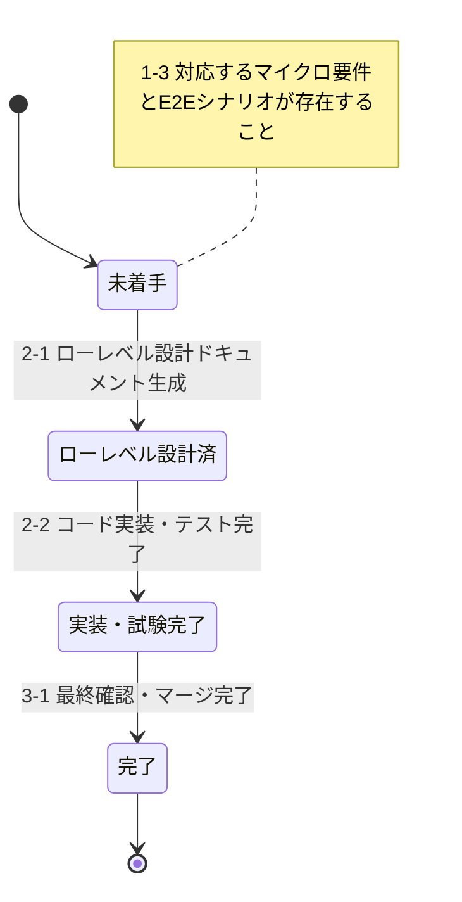

# Development Status

このドキュメントは、プロジェクトの開発状況を要件IDごとに管理します。

## マイクロ要件共通

### 要件定義

要件定義書（REQ-000）: **作成済**

要件定義書（REQ-000）へ反映済みの要件ID一覧は以下：

- UC001-UC004

### ハイレベル設計

作成済みドキュメント:

- `docs/design/actors.md` - アクター一覧
- `docs/design/deployment-diagram.md` - デプロイメント図
- `docs/design/screen-design.md` - 画面設計書（ハイレベル部分）
- `docs/design/holiday-data-specification.md` - 内閣府CSVの同梱・更新・収録期間の扱い
- `docs/design/database-table-definitions.md` - テーブル定義書（ハイレベル部分）
- `docs/design/openapi.yaml` - API設計書（ハイレベル部分）
- `docs/design/message-definition.md` - メッセージ定義書（構造のみ）

ハイレベル設計ドキュメントへ反映済みの要件ID：

- UC001-UC004（全要件のハイレベル設計完了）

### コードスケルトン生成

**状態**: 完了（2025-11-18）

生成済みコードスケルトン:

**バックエンド** (`backend/`):
- プロジェクト設定: `pom.xml`, `compose.yaml`, `application.yml`
- データベース初期化: `init-db/01-schema.sql`, `init-db/02-master-data.sql`
- アプリケーションコード:
  - `AttendanceSystemApplication.java` - メインアプリケーション
  - `controller/AttendanceController.java` - REST APIエンドポイント
  - `service/AttendanceService.java` - ビジネスロジック層
  - `repository/AttendanceRecordRepository.java` - データアクセス層
  - `entity/AttendanceRecord.java` - JPAエンティティ
  - `dto/AttendanceRequest.java`, `dto/AttendanceResponse.java` - DTO
- テストコード:
  - `AttendanceSystemApplicationTests.java` - アプリケーション起動テスト
  - `controller/AttendanceControllerTest.java` - コントローラーテスト
  - `service/AttendanceServiceTest.java` - サービステスト
  - `repository/AttendanceRecordRepositoryTest.java` - リポジトリテスト
- ドキュメント: `backend/README.md`

**フロントエンド** (`frontend/`):
- プロジェクト設定: `package.json`, `vite.config.ts`, `tsconfig.json`, `.eslintrc.cjs`
- アプリケーションコード:
  - `main.tsx` - エントリーポイント
  - `App.tsx` - ルートコンポーネント
  - `pages/CalendarPage.tsx` - メイン画面
  - `components/Calendar.tsx` - カレンダーコンポーネント
  - `components/WorkTimeForm.tsx` - 勤務時間入力フォーム
  - `components/LeaveForm.tsx` - 休暇登録フォーム
  - `services/attendanceService.ts` - API通信サービス
  - `types/attendance.ts` - 型定義
- ドキュメント: `frontend/README.md`

**ビルド・テスト確認済み**:
- バックエンド: `mvn clean compile` ✓, `mvn test` ✓ (全9テスト成功)
- フロントエンド: `pnpm install` ✓, `pnpm build` ✓

コードスケルトンへ反映済みの要件ID：

- UC001-UC004（全要件のスケルトンコード生成完了）

## 各マイクロ要件

以下は `docs/requirements/` および対応する E2E シナリオに基づく最新のユースケース管理テーブルです。

| 要件ID    | 名前           | 状態             | 対応E2Eシナリオ                               | 他マイクロ要件の依存関係 |
| --------- | -------------- | ---------------- | --------------------------------------------- | ------------------------ |
| REQ-UC001 | システム起動   | 完了             | e2e/features/REQ-UC001-システム起動.feature   | -                        |
| REQ-UC002 | カレンダー操作 | 完了             | e2e/features/REQ-UC002-カレンダー操作.feature | REQ-UC001                |
| REQ-UC003 | 勤務時間入力   | 完了             | e2e/features/REQ-UC003-勤務時間入力.feature   | REQ-UC001, REQ-UC002     |
| REQ-UC004 | 休暇登録       | 完了             | e2e/features/REQ-UC004-休暇登録.feature       | REQ-UC001, REQ-UC002     |

### REQ-UC003 ローレベル設計成果物

| 成果物 | ファイル | 更新内容 |
| ------ | -------- | -------- |
| シーケンス図 | [SEQ-REQ-UC003-勤務時間入力.md](../design/domain/sequence/SEQ-REQ-UC003-勤務時間入力.md) | 勤怠取得・登録／更新、入力エラー、未来日付のフローを定義 |
| 画面設計 | [screen-design.md](../design/screen-design.md) | SCR-002の画面項目、バリデーション、API、メッセージを定義 |
| テーブル定義 | [database-table-definitions.md](../design/database-table-definitions.md) | 勤怠カラム対応、制約、検索・登録／更新ルールを定義 |
| API設計 | [openapi.yaml](../design/openapi.yaml) | UC003の登録・更新、日付別取得のスキーマと応答を定義 |
| メッセージ定義 | [message-definition.md](../design/message-definition.md) | 保存成功、入力検証、形式エラー等のメッセージを定義 |

**レビュー状態**: ステップ2.1～2.5の成果物は、2026-10-27にユーザー承認済み。

**E2E仕様変更の承認状態**: 各シナリオへの「勤務時間入力フォームを開く」手順の追加は、2026-10-27にユーザー承認済み。

### REQ-UC003 実装・試験成果物

| 成果物 | ファイル | 内容 |
| ------ | -------- | ---- |
| バックエンドAPI | `backend/src/main/java/com/attendance/controller/AttendanceController.java`, `backend/src/main/java/com/attendance/service/AttendanceService.java` | 勤怠の登録・更新、日付別取得、入力検証、エラーレスポンスを実装 |
| バックエンドテスト | `backend/src/test/java/com/attendance/` | サービス、コントローラー、日付別リポジトリ検索をテスト |
| フロントエンド | `frontend/src/components/WorkTimeForm.tsx`, `frontend/src/pages/CalendarPage.tsx`, `frontend/src/services/attendanceService.ts` | 既存勤怠の表示、入力検証、保存、成功・エラー表示を実装 |
| E2Eテスト | `e2e/features/REQ-UC003-勤務時間入力.feature`, `e2e/features/step_definitions/req-uc003-work-time-input.steps.ts` | 登録、入力エラー、未来日付、更新、取得の6シナリオを実装 |

**試験結果**: バックエンド `mvn test`、フロントエンド `pnpm build`／`pnpm lint`、UC003 E2E（6シナリオ・52ステップ）がすべて成功。

### 状態定義

#### REQ-XXX: 各マイクロ要件

- **未着手**: マイクロ要件仕様書および E2E テストシナリオが生成・更新されている状態
- **ローレベル設計済**: ローレベル設計ドキュメントが生成・更新されている状態
- **コードスケルトン済**: コードスケルトンが生成・更新されている状態
- **実装・試験完了**: コード実装およびテストコードが生成・更新され、単体テストおよび E2E テストが完了している状態
- **完了**: マージ済みですべての関連ドキュメントとコードが最終確認されている状態

---

**最終更新日**: 2026-10-28
